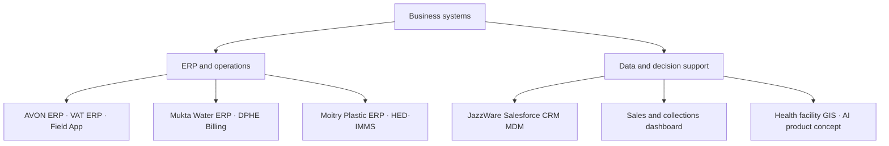

# A. Z. M. Rafkat

**Digital Transformation & Analytics Lead · Product Strategy · Solution Architecture**

I work with operations, finance, and engineering teams to turn business requirements into systems people can use. My work spans workflow design, delivery, and reporting for the teams that run the business.

## Expertise

Digital transformation · ERP and CRM · Product strategy · Solution design · Analytics and reporting · Cross-functional delivery

## Project Map

## Featured Portfolio Projects

### Enterprise systems

- [Manufacturing ERP case study](https://github.com/azmRafkat/manufacturing-erp-case-study) · Fictional order-to-invoice workflow covering production, quality, costing, and finance.
- **AVON ERP** · Designed enterprise workflows supporting sales, collections, credit control, and management reporting for an animal health business.
- **AVON VAT ERP** · Designed VAT system workflows and reporting to support tax operations and government compliance.
- **AVON Field App** · Designed field data collection for customer, sales, and collection information, with credit control review before ERP entry.
- [DPHE Water Billing System](https://github.com/azmRafkat/dphe-water-billing-case-study) · Illustrative billing workflow and operational controls for a public water service across 23 unions.
- **Mukta Water ERP** · Led solution design for ERP workflows supporting water operations and business management.
- **Moitry Plastic ERP** · Led solution design for ERP workflows supporting plastic manufacturing and business operations.
- **HED-IMMS** · Worked on the Health Engineering Division's Infrastructure Management & Monitoring System, including facility data and location information for the portal.
- [Manufacturing ERP for Nordic Audio Labs](https://github.com/azmRafkat/manufacturing-erp-case-study) · Production, orders, sales, costing, and accounting workflow case study.

### Data, analytics, and product design

- [JazzWare Salesforce CRM MDM](https://github.com/azmRafkat/master-data-management-case-study) · Led Salesforce customer data cleansing, enrichment, and restructuring, including alignment with IoT data.
- [Health Facility Data and GIS](https://github.com/azmRafkat/health-facility-gis-case-study) · Sample facility registry, map validation, and location quality checks.
- [Sales and collections dashboard](https://azmrafkat.github.io/sales-collections-dashboard/) · Working demo with synthetic regional sales, collections, receivables, and margin.
- [Fish Farming AI Product Concept](https://github.com/azmRafkat/fish-farming-ai-concept) · Bangla-first farmer learning and pond support concept with expert referral considerations.

Case study examples use fictional data where applicable and demonstrate workflow and product thinking.

[Connect on LinkedIn](https://www.linkedin.com/in/a-z-m-rafkat-10404042/)
